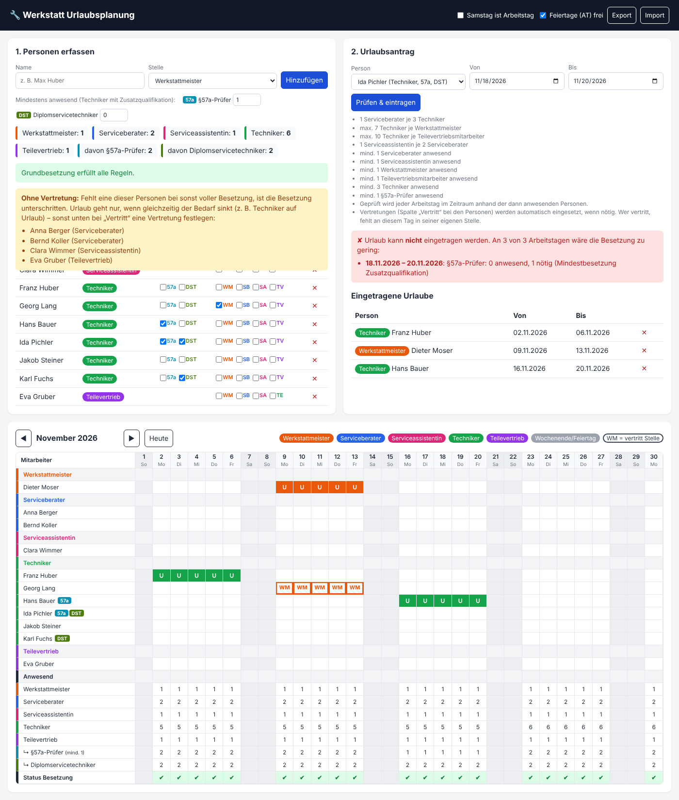

# Werkstatt Urlaubsplanung

Browser-App zur Urlaubsplanung einer Werkstatt. Jeder Urlaubsantrag wird automatisch gegen die
Mindestbesetzung geprüft und nur eingetragen, wenn an **jedem Arbeitstag** des Zeitraums die
Stellenverhältnisse eingehalten bleiben. Andernfalls zeigt die App Tage und Grund an.

## Starten

`index.html` im Browser öffnen – keine Installation, kein Server nötig.
Die Daten liegen im `localStorage` des Browsers; mit **Export/Import** (JSON) sichern oder auf
einen anderen Rechner übertragen.

## Regeln (geprüft je Arbeitstag, anhand der dann anwesenden Personen)

| Regel | Bedeutung |
|---|---|
| 1 Serviceberater je 3 Techniker | Serviceberater ≥ ⌈Techniker / 3⌉ |
| max. 7 Techniker je Werkstattmeister | Werkstattmeister ≥ ⌈Techniker / 7⌉ |
| max. 10 Techniker je Teilevertrieb | Teilevertrieb ≥ ⌈Techniker / 10⌉ |
| 1 Serviceassistentin je 2 Serviceberater | Serviceassistentin ≥ ⌈Serviceberater / 2⌉ |

Zusätzlich gilt immer die **Mindestbesetzung**: mind. 1 Serviceberater, 1 Serviceassistentin,
1 Werkstattmeister, 1 Teilevertriebsmitarbeiter und 3 Techniker.

## Zusatzqualifikationen der Techniker

Techniker können in der Spalte **Zusatz** als **§57a-Prüfer** und/oder **Diplomservicetechniker**
markiert werden. Wie viele davon an jedem Arbeitstag mindestens anwesend sein müssen, wird oben im
Personenbereich eingestellt (Standard: 1 §57a-Prüfer, 0 Diplomservicetechniker = keine Prüfung).
Gezählt werden alle anwesenden Techniker mit der Qualifikation – auch wenn sie an dem Tag eine andere
Stelle vertreten. Im Kalender stehen die Qualifikationen als Kürzel beim Namen und als eigene Zeilen
unter „Anwesend“.

## Vertretungen

In der Personenliste legt die Spalte **Vertritt** fest, welche Stellen eine Person bei Bedarf
übernehmen darf (z. B. ein Techniker vertritt den Werkstattmeister). Bei der Prüfung setzt die App
Vertretungen automatisch und nur bei Bedarf ein:

- Wer vertritt, zählt an diesem Tag in der vertretenen Stelle und **fehlt in der eigenen**.
  Es wird also nichts doppelt gezählt.
- Die App wählt pro Tag die Aufteilung mit der geringsten Unterbesetzung und dabei möglichst
  wenigen Vertretungseinsätzen.
- Vertretungen werden nicht gespeichert, sondern jeden Tag neu ermittelt. Will die vertretende
  Person später selbst Urlaub nehmen, wird geprüft, ob dann noch jemand anderes einspringen kann.
- Im Kalender ist ein Vertretungstag mit dem Kürzel der vertretenen Stelle markiert (z. B. `WM`).

Personen ohne Vertretung (wo bei voller Besetzung niemand fehlen darf) werden im Personenbereich
gelb markiert.

- Arbeitstage: Mo–Fr (Samstag optional), österreichische gesetzliche Feiertage optional frei.
- Ist die Grundbesetzung schon ohne Urlaub unterbesetzt, blockiert das nur Anträge, die die
  Lage verschärfen – nicht unbeteiligte Stellen.

## Aufbau

- `rules.js` – Fachlogik (Regeln, Feiertage, Prüfung), auch in Node nutzbar
- `app.js` – Oberfläche (Personen, Antrag, Monatskalender)
- `test/` – Tests: `node --test test/*.test.js`

